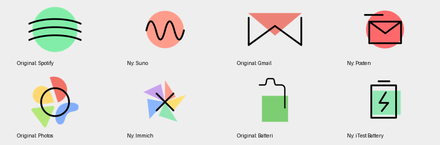
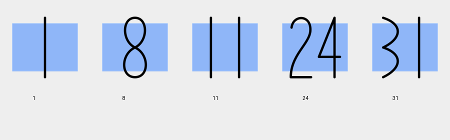

# Appstract Pixel 9

A community fork of [mirrorkeydev/Appstract](https://github.com/mirrorkeydev/Appstract) with **86 additional icons** and a **dynamic calendar showing the current day of the month**.

[Download the latest APK](https://github.com/oddhap/Appstract/releases/latest)

- All 591 original Appstract icons are retained.
- 86 additional icons follow Appstract's large geometric shapes, limited palette, and 6 px strokes.
- 31 calendar date variants, with dynamic Google Calendar bindings.
- Transparent light and dark PNG exports at 192 × 192, plus editable SVG sources.
- Updated activity mappings for recent app versions.





[View all 86 new icons](previews/new-icons.png)

## Install

Download `Appstract-Pixel9.apk` from [Releases](https://github.com/oddhap/Appstract/releases/latest), install it, and select **Appstract Pixel 9** in your icon-pack-compatible launcher. Its package name is `dev.appstract.pixel9`, so it installs alongside Appstract.

Dynamic dates follow the device's local date when the launcher supports the dynamic calendar API. Murine Launcher supports this convention. A manually selected date image is a static icon; use the calendar app's default icon from the pack for automatic dates.

## Artwork and configuration

- `icons/svgs/custom_*.svg`: the new editable designs.
- `icons/appstract-light/custom_*.png`: black-stroke exports.
- `icons/appstract-dark/custom_*.png`: white-stroke exports.
- `custom_calendar_1` through `custom_calendar_31`: daily calendar variants.
- `app/xml/appfilter.xml`: static mappings and dynamic calendar prefixes.
- `app/xml/drawable.xml`: the icon-picker catalog.

The original artwork remains in its original folders. New icons follow the upstream [design guide](CONTRIBUTING.md).

## Build the APK

Like the upstream repository, this repository primarily distributes artwork and configuration. The included build script overlays these resources on the public [yangchoo/Appstract v5.0.6 dashboard APK](https://github.com/yangchoo/Appstract/releases/tag/v5.0.6); it does not contain a separate Gradle dashboard project.

Requirements: Python 3, a JDK on PATH, and Apktool **3.0.3**. On macOS, `brew install apktool` installs Apktool and its Java dependency. Ensure Java is on PATH, for example `export PATH="$(brew --prefix openjdk)/bin:$PATH"`.

```sh
python3 scripts/build_pack.py
```

The script downloads the pinned public base APK, checks its SHA-256, decodes it in a temporary build folder, copies the artwork and mappings, verifies resource references, and produces `output/Appstract-Pixel9-unsigned.apk`. PNG exports are checked in, so rasterization tools are not required to build.

To create an installable APK, use your own Android signing key and [uber-apk-signer 1.3.0](https://github.com/patrickfav/uber-apk-signer/releases/tag/v1.3.0):

```sh
# Set APPSTRACT_KEYSTORE_PASSWORD in your environment without committing it.
python3 scripts/build_pack.py \
  --keystore /path/to/your.keystore \
  --ks-alias pixel9 \
  --signer-jar /path/to/uber-apk-signer-1.3.0.jar
```

This produces `output/Appstract-Pixel9.apk`. Release APKs use the maintainer's private key; that key is not included in this repository. Your own signed builds use your signing identity.

The expected base APK SHA-256 is `dfdae011e8057f3473818beb1d79f001766ca101b7aaab548083f1f880840541`. The signer JAR used for this release has SHA-256 `e1299fd6fcf4da527dd53735b56127e8ea922a321128123b9c32d619bba1d835`.

## License and attribution

Apache License 2.0. See [LICENSE.md](LICENSE.md) and [NOTICE.md](NOTICE.md) for the original artwork, maintained dashboard, third-party attribution, and this fork's additions.

---

## Original upstream README

# Appstract Icon Pack

> **IMPORTANT:** This project is now archived, but all nearly 600 icons will continue to be available for public use and enjoyment [here](https://github.com/mirrorkeydev/Appstract/tree/master/icons). Please use these in whatever fashion you like -- FOSS applications are particularly encouraged.

An abstract Android icon pack. Built on [CandyBar Library](https://github.com/zixpo/candybar-sample). Available on the [Play Store](https://play.google.com/store/apps/details?id=com.melon.appstract).


# Design Ethos
The design ethos is explained in the former [contribution guide](https://github.com/mirrorkeydev/Appstract/blob/master/CONTRIBUTING.md).

# Acknowledgements
Appstract is currently built on [Sarsa Murmu's](https://github.com/sarsamurmu) maintained Candybar fork: [zixpo/candybar-sample](https://github.com/zixpo/candybar-sample).

# Releases

#### V1.0.0 April 2018
First release, containing approximately 60 icons. Released as an exploratory high school senior project. Built on (the now discontinued) Polar Dashboard.

#### V2.0.0 Dec 2018
Second major release. Added over 100 new icons, ported the app to Blueprint Dashboard, fixed emails, links, and design inconsistencies. 

#### V2.1.0 Jan 2019
Minor bug fixes and license checker fix.

#### V3.0.0 March 2019
Third major release. Added some new icons, ported the app to CandyBar Dashboard. Now allows for premium icon requests and fixes an issue with selecting individual icons.

#### V3.3.3 October 2019
Removed premium icon requests. Added some more new icons based on the most popular free icon requests and updated bindings to previous icons.

#### V4.0.0 November 2020
Fourth major release. Ported to the maintained fork of CandyBar [here](https://github.com/zixpo/candybar-sample). Opened up app to [contributions](https://github.com/mirrorkeydev/Appstract/blob/master/CONTRIBUTING.md).

#### V4.0.4 March 2021
Added more contributor icons. Added "old" icon versions so users can manually apply them.

#### V4.0.5 June 2021
Bump version of CandyBar to v3.11.0. Add more icons.

#### V4.0.6 December 2021
Bump version of CandyBar to v3.13.1. Add more icons from contributors and improve bindings.

# License
All work in this repository is licensed under Apache 2.0.
